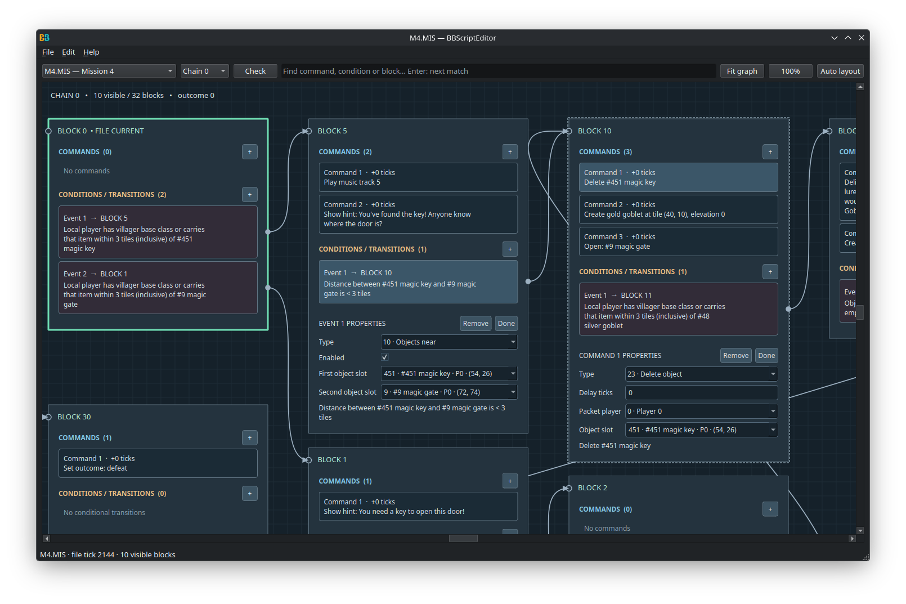

# BBTools
Collection of tools for Beasts and Bumpkins

# BBScriptEditor

- Visual graph editor for mission and savegame scripts.
- Editable commands and conditions with drag-and-drop transitions.
- Searchable object and class lists.
- Script validation and Undo/Redo.
- Open campaign archives or individual files and save changes in the original format.
- Native C++20 / Qt 6 desktop application; game files are not bundled.



# MAPViewer
MAPViewer is a tool to visualize the mission and savegame files.


# SpriteViewer


# MAP/SAV file structure
| Data type                      | Name               |
|--------------------------------|--------------------|
| char[3]                        | signature          |
| char[5]                        | version            |
| char[64]                       | mission_name       |
| byte                           | size_x             |
| byte                           | size_y             |
| MapTile[size_x][size_y]        | tiles              |
| int                            | ptr_to_objects_arr |
| int                            | ptr_to_smth2_arr   |
| int                            | size_of_objects_arr|
| MapObject[size_of_objects_arr] | objects            |

# Structure MapObject
```c
#pragma pack(push, 1)
struct MapObject
{
  MapObject *unk110;
  MapObject *unk111;
  MapObject *unk112;
  MapObject *unk113;
  MapObject *unk114;
  MapObject *unk99;
  MapObject *unk115;
  MapObject *unk116;
  MapObject *unk117;
  MapObject *unk118;
  MapObject *unk119;
  MapObject *unk120;
  MapObject *unk121;
  MapObject *unk122;
  int unk1;
  char name[32];
  int unk131;
  unsigned __int8 data1[2];
  int unk5;
  int unk7;
  int unk29;
  int unk30;
  int unk31;
  int unk62;
  int unk63;
  int unk64;
  unsigned __int8 data5_1[12];
  int unk_index1;
  unsigned __int8 data2[10];
  int unk32;
  unsigned __int16 health;
  unsigned __int8 data2_1[50];
  unsigned __int8 class_id;
  unsigned __int8 data3[3];
  unsigned __int8 x;
  unsigned __int8 y;
  unsigned __int8 data6[9];
  unsigned __int8 unk77;
  unsigned __int8 unk78;
  unsigned __int8 unk79;
  unsigned __int8 unk80;
  unsigned __int8 unk81;
  unsigned __int8 unk82;
  unsigned __int8 unk83;
  unsigned __int8 unk11;
  unsigned __int8 unk12;
  int unk3;
  unsigned __int8 unk3_size;
  unsigned __int8 unk17;
  unsigned __int8 unk18;
  unsigned __int8 unk19;
  unsigned __int8 unk10;
  unsigned __int8 unk21;
  unsigned __int8 unk22;
  unsigned __int8 unk23;
  unsigned __int8 unk24;
  unsigned __int8 unk25;
  unsigned __int8 unk26;
  unsigned __int8 data8[9];
  unsigned __int8 unk15;
  unsigned __int8 data10[15];
  unsigned __int8 unk14;
  unsigned __int8 data9[8];
  unsigned __int8 unk103;
  unsigned __int8 data9_1[12];
  unsigned __int8 unk4;
  unsigned __int8 unk8;
  unsigned __int8 unk9;
  unsigned __int8 unk13;
  unsigned __int8 data7[12];
};
#pragma pack(pop)
```

# Map objects
| Class ID | Description            |
|----------|------------------------|
| 0        | Indestructible tree    |
| 1        | Church                 |
| 2        | Peasant hut            |
| 5        | Tree                   |
| 6        | Spruce                 |
| 7        | Fire                   |
| 25       | Crate                  |
| 33       | Egg (zombie spawner)   |
| 36       | Spike                  |
| 37       | Skulls (mine)          |
| 38       | Gas mold               |
| 41       | Airstrike              |
| 58       | Corpse                 |
| 78       | Wheat                  |
| 83       | Mushroom               |
| 98       | Flagpost               |
| 103      | Villager               |
| 111      | Chicken                |
| 143      | Campfire               |
| 159      | Goblet                 |
| 171      | Cow                    |


## Cheat Mode

The game contains a hidden cheat mode and map editor that can be enabled by patching the executable.

**Cheat Mode Flag:** `dword_4842A0` (global variable)
- Address: `0x004842A0`
- Type: `int`
- Value: `0` = disabled, `1` = enabled

**Detection Code:**
```asm
.text:0040C49B A1 A0 42 48 00                       mov     eax, dword_4842A0
.text:0040C4A0 85 C0                                test    eax, eax
.text:0040C4A2 74 18                                jz      short loc_40C4BC
.text:0040C4A4 6A 02                                push    2
.text:0040C4A6 B9 70 5B 5C 00                       mov     ecx, offset unk_5C5B70
.text:0040C4AB 6A 06                                push    6
.text:0040C4AD 68 76 02 00 00                       push    276h
.text:0040C4B2 68 14 6E 48 00                       push    offset aCheat   ; "CHEAT"
.text:0040C4B7 E8 A4 40 02 00                       call    DrawString
```

The `jz` (jump if zero) instruction at `0x0040C4A2` checks if `dword_4842A0` equals 0.

### Enabling Cheat Mode

1. Open `beasts.exe` in a hex editor
2. Navigate to address `0x004842A0`
3. Change value from `00 00 00 00` to `01 00 00 00`
4. Save the patched executable

**Or in IDA Pro:**
Rename dword_4842A0 to cheat_mode and set value equal to 1. Apply patches to beasts.exe 

When cheat mode is enabled, the text **"CHEAT"** appears in the top-right corner of the screen during gameplay.


| Effect                          | Action         |
|---------------------------------|----------------|
| Unlimited gold                  | [G]            |
| Duplicate last created object   | [C]            |
| Remove fog of war               | [Ctrl] + [F6]  |

# TODO
+ Sounds files (ambient and speach)
+ Drawing info of objects
